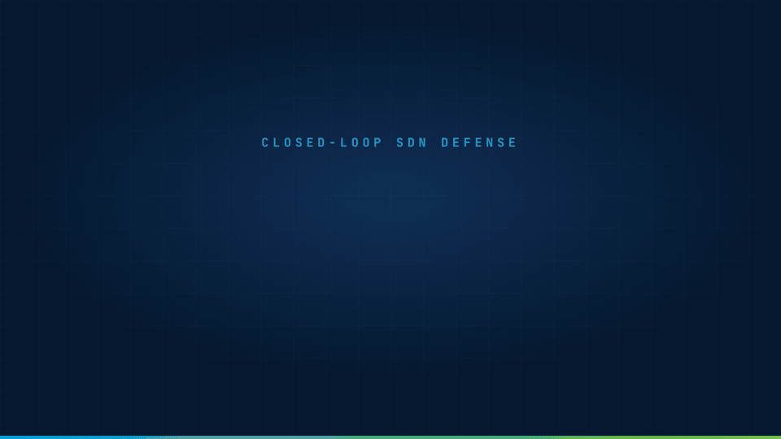
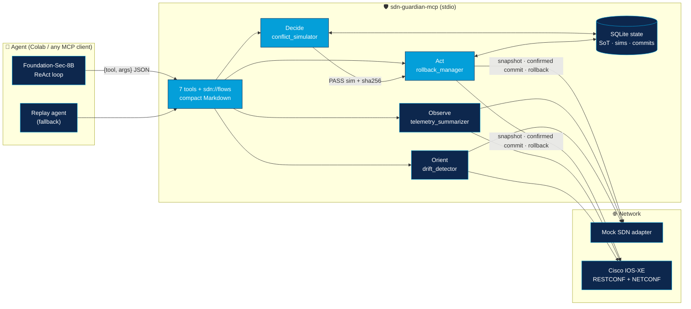

<div align="center">

# SDN Guardian MCP

### Closed-loop SDN defense with safe policy execution for Cisco Foundation-Sec-8B

[](https://github.com/faithere1/sdn-guardian-mcp/actions/workflows/ci.yml)
[](https://colab.research.google.com/github/faithere1/sdn-guardian-mcp/blob/main/notebooks/Cisco_Foundation_Sec_8B_SDN_Guardian_Colab.ipynb)
[](https://modelcontextprotocol.io)
[](https://huggingface.co/fdtn-ai/Foundation-Sec-8B-Instruct)
[](pyproject.toml)
[](LICENSE)



**An LLM agent finds the attack and proposes the block. The server checks the rule first, and
rolls it back on its own if nobody confirms it.**

[Overview](#overview) · [How it works](#how-it-works) · [Quick start](#installation) ·
[Cisco sandbox](#cisco-sandbox-configuration) · [Safety model](#safety-model--limitations) ·
[Future work](#future-work)

</div>

---

## Overview

SDN Guardian is an [MCP](https://modelcontextprotocol.io) server that lets Cisco's open-weight
security model, [`fdtn-ai/Foundation-Sec-8B-Instruct`](https://huggingface.co/fdtn-ai/Foundation-Sec-8B-Instruct),
defend a software-defined network **without being able to break it**. The agent runs an OODA
loop through seven tools; every safety rule is enforced by the server, not by the prompt.

| Stage | Tool | Returns |
|:--|:--|:--|
| 🔍 **Observe** | `get_traffic_anomalies` | Per-source summary; flags SYN floods and high-rate sources |
| 🧭 **Orient** | `detect_network_drift` | Live switchport state vs. the Source of Truth (VLAN, enabled, description) |
| ⚖️ **Decide** | `simulate_flow_impact` | PASS/FAIL dry run, the conflicts, a concrete fix and a `simulation_id` |
| ⚡ **Act** | `push_safe_sdn_policy` | Provisional install behind a dead-man's switch (auto-rollback) |
| ✅ **Act** | `confirm_commit` | Runs the health check; commits if healthy, otherwise rolls back |
| 📋 Inspect | `get_commit_status`, `list_flow_rules`, resource `sdn://flows` | Commit and flow-table state |

Every tool answers in a few lines of Markdown, never raw JSON or YANG, so an 8B model can
reason over the results in a small context window.

### Highlights

- **Validated on a real GPU.** Foundation-Sec-8B (bf16, NVIDIA L4) ran the full defense in Colab:
  6 tool calls, 0 parse retries, a full-source block committed, and a truthful summary
  ([validation log](docs/COLAB_VALIDATION.md)).
- **Device-native rollback.** On Cisco IOS-XE, writes use NETCONF `confirmed-commit`, so the
  router itself reverts if the guardian dies before confirming.
- **Fixes, not just failures.** A rejected rule comes back with the fix, e.g.
  `Minimum safe priority: 101`, which the model follows.
- **112 tests** cover the simulator, the rollback timer, the stdio MCP server end to end, the
  IOS-XE adapter against a simulated device, and the ReAct loop with a fake LLM.

## Problem Statement

LLM agents are good at reading telemetry and proposing a block rule. They are bad at the parts
that take a network down:

| Risk | What goes wrong |
|:--|:--|
| **Rule precedence** | A new DENY below an existing broad ALLOW never matches (shadowing). A broad DENY above the management subnet locks out the controller. |
| **Stale state** | A rule that was safe when checked may be unsafe after the table changed. |
| **No undo** | A bad push has to be noticed and reverted by a human. |
| **Drift** | The Source of Truth says VLAN 20, the device says VLAN 99, so VLAN-scoped policy silently misses. |
| **Hallucinated outcomes** | The model reports actions it never took ("drift reconciled"). |

Prompting the model to "be careful" does not solve these. SDN Guardian moves the checks into the
server, so they hold no matter what the model outputs.

## How It Works



1. **Observe.** Telemetry samples are aggregated per source IP. A SYN flood is flagged at
   ≥100 SYN/s with a SYN:SYN-ACK ratio ≥3 (critical at ≥1000/s).
2. **Orient.** Live interface state is diffed against the SoT, with an impact line (e.g. "prefer
   IP-based rules").
3. **Decide.** The candidate `FlowRule(priority, src_cidr, dst_cidr, protocol, dst_port_range,
   action)` is checked against every rule in the table (higher priority wins, as in OpenFlow).
   Detected relations: `SHADOWED`, `OVERRIDES`, `GENERALIZATION`, `CORRELATION`, `REDUNDANT`
   and `MGMT_LOCKOUT`. `SHADOWED` and `MGMT_LOCKOUT` fail, and the report includes the fix. The
   simulation is stored with a sha256 of the normalized rule and the flow-table version.
4. **Act.** `push_safe_sdn_policy` takes only a `simulation_id`. The server reloads the rule
   from the stored PASS simulation, rejects it if the table changed since, snapshots the table,
   installs the rule and starts a timer. `confirm_commit` runs the health check itself (the
   controller and management subnet must stay reachable). If the check fails, or nobody confirms
   before the deadline, the snapshot is restored.

**The demo scenario.** Attacker `10.10.20.45` floods the controller `10.10.10.10` from
switchport Gi0/2. Rule #10 (`ALLOW 10.10.20.0/24`, priority 100) is a trap: a DENY at or below
priority 100 is shadowed by it. The agent has to read the fix, re-simulate at priority ≥101,
push and confirm. A bonus run pushes a rule, never confirms it, and shows the table restored.

## Installation

### Local

Requires Python ≥3.10.

```bash
git clone https://github.com/faithere1/sdn-guardian-mcp.git
cd sdn-guardian-mcp
python3 -m venv .venv
.venv/bin/pip install -e ".[dev]"          # add ,live for IOS-XE, ,llm for the local model
cp .env.example .env                       # defaults to mock mode
.venv/bin/ruff check . && .venv/bin/pytest
```

| Extra | Adds |
|:--|:--|
| `live` | ncclient for NETCONF |
| `llm` | transformers, accelerate, bitsandbytes |
| `dev` | pytest, pytest-asyncio, ruff |

Exact versions are pinned in `requirements.txt`.

> [!NOTE]
> macOS can mark the editable-install `.pth` file as hidden, and Python then skips it
> (`No module named 'sdn_guardian'`). Set `PYTHONPATH=src` when running modules directly.
> Pytest already does this.

### Colab

Click **Open in Colab**, pick a GPU runtime, optionally add `HF_TOKEN` in Colab **Secrets**
(with notebook access), and run all cells. The notebook clones this repo, installs `.[llm,live]`
and picks the model tier from the GPU:

| GPU | Tier | Status |
|:--|:--|:--|
| L4 / A100 (≥20 GB, compute capability ≥8.0) | bf16 (vLLM on A100 if installed) | ✅ Validated on L4 |
| T4 (≥6 GB) | 4-bit NF4 | ⏳ [Future work](#future-work) |
| None / load failure | Replay agent | ✅ Validated |

> [!TIP]
> Rerunning after a code change? Delete `/content/sdn-guardian-mcp` first (or reset the
> runtime). The install cell skips the clone when that folder exists.

## Cisco Sandbox Configuration

Mock mode needs no device. Live mode drives a Cisco IOS-XE device (Catalyst 8000V, CSR1000v,
Catalyst 9000): RESTCONF for reads, NETCONF candidate datastore + confirmed commit for writes.

**1. Get a device.** A reservable [Cisco DevNet sandbox](https://developer.cisco.com/site/sandbox/)
(IOS-XE / Cat8kv) or your own lab device. The shared always-on sandbox is often read-only for
NETCONF candidate writes, so use it for reads only.

**2. Enable the APIs** (privilege 15 user required):

```
ip http secure-server
restconf
netconf-yang
netconf-yang feature candidate-datastore
```

**3. Create the guardian-owned ACL** and bind it to the interfaces it guards. The guardian
treats this ACL as its flow table (`seq = 10000 - priority`) and never touches other ACLs:

```
ip access-list extended SDN-GUARDIAN
 9900 permit ip any any
interface GigabitEthernet2
 ip access-group SDN-GUARDIAN in
```

**4. Configure** `.env` (or the notebook's §5 form):

```bash
SDN_GUARDIAN_MODE=live
SDN_GUARDIAN_DB=./sdn_guardian_live.db
IOSXE_HOST=<device or sandbox host>
IOSXE_USERNAME=<user>
IOSXE_PASSWORD=<password>
IOSXE_RESTCONF_PORT=443
IOSXE_NETCONF_PORT=830
IOSXE_VERIFY_TLS=false        # sandboxes use self-signed certs
IOSXE_ACL_NAME=SDN-GUARDIAN
```

Live mode has no telemetry source (that needs NetFlow) and no seeded Source of Truth, so seed
the SoT for the interfaces you check and start the trace at drift/simulate (notebook §5 shows
how). ACEs the rule model cannot represent (source ports, GRE, non-contiguous wildcards) raise an
error instead of being silently widened.

## Usage Examples

### Replay demo (no GPU, no device)

```bash
PYTHONPATH=src .venv/bin/python -m sdn_guardian.agent.replay_agent --scenario canonical
```

```text
### 3. simulate_flow_impact(src_cidr='10.10.20.45/32', action='deny', priority=40)
**Simulation `sim-55ee0d44ba50`: FAIL** (flow table v1)
Rule: #21 prio 40 DENY any 10.10.20.45/32 -> 0.0.0.0/0
- SHADOWED (block): fully covered by higher-precedence #10 prio 100 ALLOW any 10.10.20.0/24 -> 0.0.0.0/0; the new rule never matches.
Fix: Minimum safe priority: 101

### 4. simulate_flow_impact(src_cidr='10.10.20.45/32', action='deny', priority=150)
**Simulation `sim-7fb514023c87`: PASS** (flow table v1)
...
### 6. confirm_commit(commit_id='commit-76095e9d3cc7')
**Commit `commit-76095e9d3cc7`: COMMITTED**
Rule: #21 prio 150 DENY any 10.10.20.45/32 -> 0.0.0.0/0
Detail: health check passed
```

`--scenario bonus` pushes a rule with a 10 s deadline, never confirms it, and shows the commit
turn `ROLLED_BACK` with the table restored. `--scenario both` runs both.

### Any MCP client (Claude Desktop, Claude Code, Cursor, …)

Run the server over stdio with `sdn-guardian-mcp` (add `--reset` to re-seed the mock demo).
[`examples/mcp_client_config.json`](examples/mcp_client_config.json) is a ready-made
`mcpServers` entry; replace `/ABSOLUTE/PATH/TO/sdn-guardian-mcp` with your clone's path. For
Claude Code:

```bash
claude mcp add sdn-guardian -e PYTHONPATH="$PWD/src" -- "$PWD/.venv/bin/sdn-guardian-mcp"
```

Then ask: *"Check for traffic anomalies and block the attacker safely."*

### From Python

```python
import asyncio

from sdn_guardian.agent.llm_backend import load_backend
from sdn_guardian.agent.react_loop import run_over_stdio

backend, tier = load_backend()          # (None, choice) -> canonical replay when no usable GPU
result = asyncio.run(run_over_stdio(backend=backend, load=False))
print(result.stop_reason, result.summary, result.summary_warnings)
```

## Safety model & limitations

**Enforced by the server, not the prompt:**

- 🔒 Only a PASS simulation can be pushed, and only if its rule hash and flow-table version still
  match. The rule comes from the stored simulation, never from push arguments.
- 🛡️ The management subnet (`SDN_GUARDIAN_PROTECTED_SUBNETS`) and controller IP cannot be blocked
  (`MGMT_LOCKOUT` fails the simulation).
- ⏱️ One pending commit at a time. Each push snapshots the table first; `timeout_s` is capped at
  300 s.
- ♻️ `confirm_commit` runs the health check itself and rolls back on failure or after the
  deadline. Pending commits are stored in SQLite; on startup `recover()` rolls back the ones that
  expired while the server was down. In live mode the device's own confirmed-commit timer is a
  second line of defense.
- 🧾 The agent's final summary is checked against the trace: claims such as "drift fixed", or a
  block without a COMMITTED confirm, are flagged in `summary_warnings`.

**Limitations:**

- Health is reachability of the controller and management subnet; it does not measure service
  impact on other hosts.
- The rule model covers IPv4 L3/L4 matches (CIDR, protocol, destination port range). No IPv6,
  source ports or VLAN-scoped rules.
- Live mode: no telemetry, one rule per priority (priority ≤ 9999), and ACL binding is left to
  the operator. It is tested against a simulated device (mocked RESTCONF/NETCONF), not yet
  against real hardware.
- The LLM tier is validated on Colab L4 (bf16) only. The summary check is a keyword heuristic for
  known failure modes, not a general fact checker.
- The mock adapter is a demo emulator, not a network simulator.

## Future work

- **T4 / 4-bit validation.** Run the notebook on a Colab T4 and record the 4-bit NF4 tier
  (load time, parse retries, rule choice) next to the L4 runs in
  [`docs/COLAB_VALIDATION.md`](docs/COLAB_VALIDATION.md). Also try vLLM on an A100.
- **Real IOS-XE hardware.** Run notebook §5 against a reservable DevNet Cat8kv sandbox and
  record the confirmed-commit and rollback behavior.
- **Live telemetry.** Feed NetFlow/IPFIX into `get_traffic_anomalies` in live mode.
- **Drift remediation.** A guarded tool to reconcile switchport config, behind the same
  simulate → push → confirm flow.
- **Richer rule model.** IPv6, source ports and VLAN-scoped rules.

## Project layout

```text
src/sdn_guardian/
├── mcp_server.py            # 7 tools + sdn://flows (stdio)
├── engine/                  # telemetry_summarizer · drift_detector · conflict_simulator · rollback_manager
├── adapters/                # mock_sdn_adapter · cisco_iosxe_adapter (RESTCONF + NETCONF)
└── agent/                   # llm_backend (GPU tiers) · react_loop · replay_agent
notebooks/                   # Colab notebook (live model + replay + rollback + live IOS-XE)
docs/COLAB_VALIDATION.md     # every Colab run, problem and fix
docs/demo-video/             # HyperFrames source of the demo GIF
```

## License

[Apache-2.0](LICENSE). Cisco, IOS-XE and DevNet are trademarks of Cisco Systems, Inc. This is an
independent project, not affiliated with or endorsed by Cisco.
